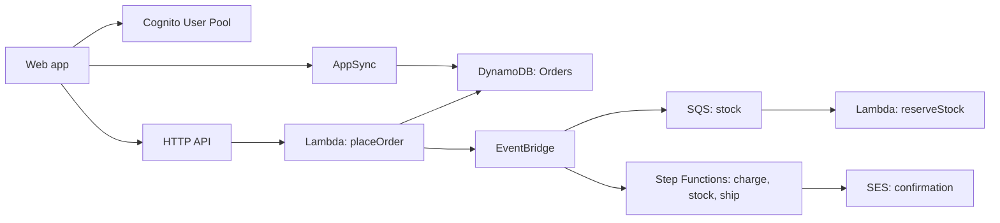

*English · [Deutsch](ARCHITEKTUR.de.md)*

# Example: order shop

Application: online shop with orders, stock and shipping

## Building blocks

| Building block | Run today as | Who runs it? | What goes wrong at night? | Managed service | Decision |
| --- | --- | --- | --- | --- | --- |
| Auth / login | Keycloak on a VM | platform team | certificate expires, VM full | Cognito User Pool | switch (lessons 09, 10) |
| API | Express server behind nginx | shop team | process hangs, out of memory | API Gateway HTTP API | switch (lesson 05) |
| Business logic | in the Express server | shop team | deploy fails | Lambda functions | switch (lessons 02, 03) |
| Database | PostgreSQL cluster | DBA | replication hangs, disk full | DynamoDB | switch for orders (lessons 06, 07), reporting stays in SQL |
| GraphQL for the app | Apollo Server | app team | subscriptions lose connections | AppSync | switch (lesson 11) |
| Background jobs, cron | cron on the VM | shop team | job runs twice or not at all | EventBridge Scheduler, SQS | switch (lesson 14) |
| Multi-step workflows | call chain in the code | shop team | payment booked, shipping missing | Step Functions | switch (lesson 13) |
| Messages between services | RabbitMQ | platform team | queue fills up | EventBridge, SQS | switch (lesson 14) |
| Sending and receiving mail | Postfix | platform team | ends up in spam | SES | switch (lesson 12) |
| Secrets | `.env` on the VM | everyone | key in the Git log | SSM Parameter Store | switch (lesson 08) |
| Logs, metrics, tracing | ELK stack | platform team | index full | CloudWatch, Powertools, OpenTelemetry | switch (lesson 16) |

## Sketch

## Result

- Auth and database save the most operations: that is where most of the night calls came from.
- Reporting stays in PostgreSQL. DynamoDB answers known questions fast, but not ad-hoc analyses.
- Costs are incurred per request. At night and on weekends the shop pays almost nothing.
