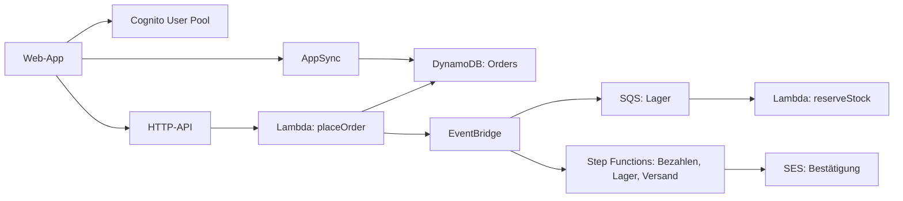

# Beispiel: Bestell-Shop

Anwendung: Online-Shop mit Bestellungen, Lager und Versand

## Bausteine

| Baustein | Heute betrieben als | Wer betreibt ihn? | Was geht nachts schief? | Managed Service | Entscheidung |
| --- | --- | --- | --- | --- | --- |
| Auth / Login | Keycloak auf einer VM | Plattform-Team | Zertifikat läuft ab, VM voll | Cognito User Pool | Wechseln (Lektion 09, 10) |
| API | Express-Server hinter nginx | Team Shop | Prozess hängt, Speicher voll | API Gateway HTTP-API | Wechseln (Lektion 05) |
| Fachlogik | Im Express-Server | Team Shop | Deploy bricht ab | Lambda-Functions | Wechseln (Lektion 02, 03) |
| Datenbank | PostgreSQL-Cluster | DBA | Replikation hängt, Disk voll | DynamoDB | Für Bestellungen wechseln (Lektion 06, 07), Reporting bleibt in SQL |
| GraphQL für die App | Apollo Server | Team App | Subscriptions verlieren Verbindungen | AppSync | Wechseln (Lektion 11) |
| Hintergrund-Jobs, Cron | Cron auf der VM | Team Shop | Job läuft doppelt oder gar nicht | EventBridge Scheduler, SQS | Wechseln (Lektion 14) |
| Abläufe über mehrere Schritte | Aufrufkette im Code | Team Shop | Zahlung gebucht, Versand fehlt | Step Functions | Wechseln (Lektion 13) |
| Nachrichten zwischen Services | RabbitMQ | Plattform-Team | Queue läuft voll | EventBridge, SQS | Wechseln (Lektion 14) |
| Mail-Versand und -Empfang | Postfix | Plattform-Team | Landet im Spam | SES | Wechseln (Lektion 12) |
| Secrets | `.env` auf der VM | alle | Key im Git-Log | SSM Parameter Store | Wechseln (Lektion 08) |
| Logs, Metriken, Tracing | ELK-Stack | Plattform-Team | Index voll | CloudWatch, Powertools, OpenTelemetry | Wechseln (Lektion 16) |

## Skizze

## Ergebnis

- Den meisten Betrieb sparen Auth und Datenbank: dort gab es die meisten nächtlichen Einsätze.
- Das Reporting bleibt in PostgreSQL. DynamoDB beantwortet bekannte Fragen schnell, Ad-hoc-Analysen aber nicht.
- Kosten fallen pro Request an. Nachts und am Wochenende zahlt der Shop fast nichts.
