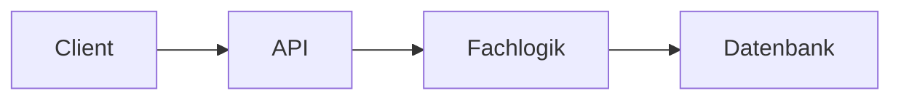

# Arbeitsblatt: Was betreibt ihr selbst?

Anwendung: _______________________

## Bausteine

| Baustein | Heute betrieben als | Wer betreibt ihn? | Was geht nachts schief? | Managed Service | Entscheidung |
| --- | --- | --- | --- | --- | --- |
| Auth / Login | | | | | |
| API | | | | | |
| Fachlogik | | | | | |
| Datenbank | | | | | |
| Hintergrund-Jobs, Cron | | | | | |
| Abläufe über mehrere Schritte | | | | | |
| Nachrichten zwischen Services | | | | | |
| Mail-Versand und -Empfang | | | | | |
| Logs, Metriken, Tracing | | | | | |

## Skizze

Zeichne die Bausteine und ihre Verbindungen. Färbe alles, was ein Managed Service übernehmen kann.

## Fragen für die Diskussion

- Welcher Baustein kostet euch heute am meisten Betriebszeit?
- Wo braucht ihr Kontrolle, die ein Managed Service nicht bietet?
- Wofür zahlt ihr heute, auch wenn niemand die Anwendung nutzt?
