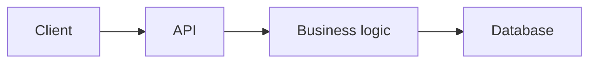

*English · [Deutsch](ARCHITEKTUR.de.md)*

# Worksheet: What does your team run itself?

Application: _______________________

## Building blocks

| Building block | Run today as | Who runs it? | What goes wrong at night? | Managed service | Decision |
| --- | --- | --- | --- | --- | --- |
| Auth / login | | | | | |
| API | | | | | |
| Business logic | | | | | |
| Database | | | | | |
| Background jobs, cron | | | | | |
| Multi-step workflows | | | | | |
| Messages between services | | | | | |
| Sending and receiving mail | | | | | |
| Logs, metrics, tracing | | | | | |

## Sketch

Draw the building blocks and their connections. Color everything a managed service can take over.

## Questions for the discussion

- Which building block costs your team the most operating time today?
- Where does your team need control that a managed service does not offer?
- What does your team pay for today even when nobody uses the application?
