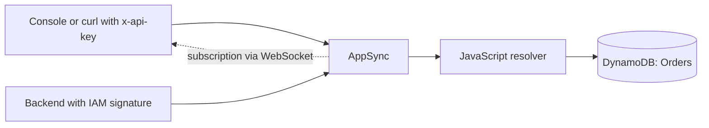

*English · [Deutsch](README.de.md)*

# 11 · GraphQL with AppSync

**ID:** `aws-appsync-graphql` · additional chapter

## Task

Build an AppSync API with the query `order`, the mutation `createOrder` and the subscription `onOrderCreated`, and write both resolvers in JavaScript. The API is secured with an API key and IAM. Exercises [09](../09-aws-cognito-user-pools) and [10](../10-aws-cognito-authorizer) show sign-in with Cognito.



## Steps

1. [`start/`](start/) contains a table and an API with `Query.order` including the resolver [`get-order.js`](start/resolvers/get-order.js). The default auth mode is an API key, IAM is the second mode.
2. In [`start/schema.graphql`](start/schema.graphql), add `OrderItemInput`, `CreateOrderInput`, `Mutation.createOrder` and `Subscription.onOrderCreated` with `@aws_subscribe`.
   - Put the directives `@aws_api_key @aws_iam` on `Mutation` and `Subscription`. With two auth modes the rule is: a type without a directive is reachable with the default mode only. As soon as a directive is present, only the listed modes count.
3. Write the resolver [`start/resolvers/create-order.js`](start/resolvers/create-order.js) with `ddb.put` from `@aws-appsync/utils/dynamodb`. The resolver generates the ID and `createdAt`, never the client.
4. Attach it to `Mutation.createOrder` in [`start/lib/orders-graphql-stack.ts`](start/lib/orders-graphql-stack.ts) with `createResolver`.
5. Remove the `.skip` in the tests. They replace the AppSync runtime with mocks and check only the logic of your resolvers.
6. Deploy and test in the AppSync console under “Queries” with the API key from the outputs:

   ```graphql
   subscription { onOrderCreated { id customerId createdAt } }      # start in a second tab
   mutation {
     createOrder(input: { customerId: "c-1", items: [{ productId: "p-1", quantity: 2, priceCents: 1299 }] }) { id }
   }
   query { order(id: "<id from the mutation>") { id items { productId quantity priceCents } } }
   ```

   Or with curl:

   ```bash
   curl -s "$GRAPHQL_URL" -H "x-api-key: $API_KEY" -H 'content-type: application/json' \
     -d '{"query":"query { order(id: \"<id>\") { id customerId } }"}'
   ```

## Check

- The subscription in the second tab shows every new order immediately.
- `order` returns `null` for an unknown ID.
- Without `x-api-key` the API responds with `UnauthorizedException`.
- The resolver runs without Lambda: AppSync talks to DynamoDB directly.

## Going further

- A backend calls the API with IAM. For that you grant its role the permission with `api.grantMutation(fn, 'createOrder')` and sign the request with SigV4.
- If another service writes directly to the table, the subscription does not notice. You send such changes through a dedicated mutation with IAM.
- If a resolver has to call three services and merge the results, the logic belongs in a Lambda function as a data source: `api.addLambdaDataSource(...)`.

## Solution

[`solution/`](solution/)
