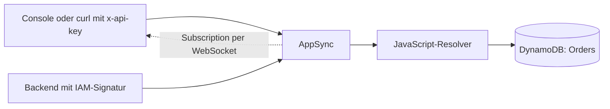

# 11 · GraphQL mit AppSync

**ID:** `aws-appsync-graphql` · Zusatzkapitel

## Aufgabe

Bau eine AppSync API mit Query `order`, Mutation `createOrder` und Subscription `onOrderCreated` und schreib beide Resolver in JavaScript. Die API ist per API Key und IAM abgesichert. Wie Nutzer sich per Cognito anmelden, zeigen die Übungen [09](../09-aws-cognito-user-pools) und [10](../10-aws-cognito-authorizer).



## Ablauf

1. [`start/`](start/) enthält Table und eine API mit `Query.order` samt Resolver [`get-order.js`](start/resolvers/get-order.js). Default-Auth ist ein API Key, IAM ist der zweite Modus.
2. Ergänze in [`start/schema.graphql`](start/schema.graphql) `OrderItemInput`, `CreateOrderInput`, `Mutation.createOrder` und `Subscription.onOrderCreated` mit `@aws_subscribe`.
   - Setz an `Mutation` und `Subscription` die Direktiven `@aws_api_key @aws_iam`. Mit zwei Auth-Modi gilt: Ein Typ ohne Direktive ist nur mit dem Default-Modus erreichbar. Sobald eine Direktive dasteht, zählen nur die genannten Modi.
3. Schreib den Resolver [`start/resolvers/create-order.js`](start/resolvers/create-order.js) mit `ddb.put` aus `@aws-appsync/utils/dynamodb`. ID und `createdAt` erzeugt der Resolver, nie der Client.
4. Häng ihn in [`start/lib/orders-graphql-stack.ts`](start/lib/orders-graphql-stack.ts) per `createResolver` an `Mutation.createOrder`.
5. Entferne das `.skip` in den Tests. Sie ersetzen die AppSync-Runtime durch Mocks und prüfen nur die Logik deiner Resolver.
6. Deploy und teste in der AppSync Console unter „Queries“ mit dem API Key aus den Outputs:

   ```graphql
   subscription { onOrderCreated { id customerId createdAt } }      # in einem zweiten Tab starten
   mutation {
     createOrder(input: { customerId: "c-1", items: [{ productId: "p-1", quantity: 2, priceCents: 1299 }] }) { id }
   }
   query { order(id: "<id aus der Mutation>") { id items { productId quantity priceCents } } }
   ```

   Oder per curl:

   ```bash
   curl -s "$GRAPHQL_URL" -H "x-api-key: $API_KEY" -H 'content-type: application/json' \
     -d '{"query":"query { order(id: \"<id>\") { id customerId } }"}'
   ```

## Prüfen

- Die Subscription im zweiten Tab zeigt jede neue Bestellung sofort an.
- `order` liefert `null` für eine unbekannte ID.
- Ohne `x-api-key` antwortet die API mit `UnauthorizedException`.
- Der Resolver läuft ohne Lambda: AppSync spricht DynamoDB direkt an.

## Zum Weiterdenken

- Ein Backend ruft die API mit IAM auf. Dafür gibst du seiner Role das Recht per `api.grantMutation(fn, 'createOrder')` und signierst den Request mit SigV4.
- Schreibt ein anderer Service direkt in die Table, merkt die Subscription nichts. Solche Änderungen schickst du über eine eigene Mutation mit IAM.
- Muss ein Resolver drei Services aufrufen und Ergebnisse zusammenführen, gehört die Logik in eine Lambda Function als Data Source: `api.addLambdaDataSource(...)`.

## Lösung

[`solution/`](solution/)
