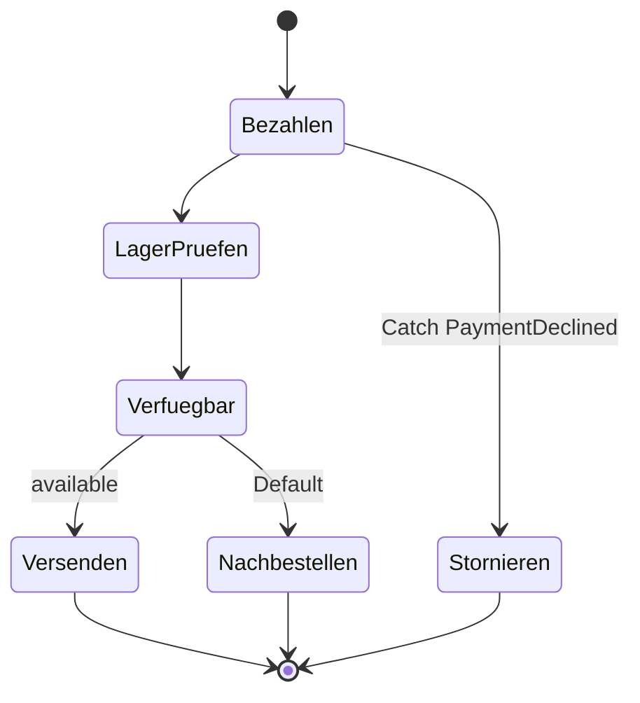

# 13 · Abläufe mit Step Functions

**ID:** `aws-step-functions`

## Aufgabe

Modelliere Bezahlen, Lager prüfen und Versand als Standard Workflow mit Retry für die Zahlung und einem Catch, der die Bestellung storniert.



## Ablauf

1. Die Schritte liegen fertig in [`start/src/steps.ts`](start/src/steps.ts) – inklusive der Fehler `PaymentProviderTimeout` und `PaymentDeclined`.
2. [`start/lib/order-workflow-stack.ts`](start/lib/order-workflow-stack.ts) verbindet nur Bezahlen und Versenden. Der Workflow nutzt schon JSONata als Query Language.
3. Ergänze die fehlenden Schritte, den Retry, den Catch und die Choice.
4. Entferne das `.skip` in [`start/test/order-workflow-stack.test.ts`](start/test/order-workflow-stack.test.ts).
5. Deploy und starte vier Ausführungen:

   ```bash
   cd exercises/13-aws-step-functions/start
   npx cdk deploy
   SM=<StateMachineArn>
   aws stepfunctions start-execution --state-machine-arn $SM \
     --input '{"orderId":"A7","amount":42,"items":[{"sku":"BOOK","quantity":1}]}'
   aws stepfunctions start-execution --state-machine-arn $SM \
     --input '{"orderId":"A8","amount":42,"items":[{"sku":"OUT_OF_STOCK-MUG","quantity":1}]}'
   aws stepfunctions start-execution --state-machine-arn $SM \
     --input '{"orderId":"A9","amount":42,"items":[],"simulate":"timeout"}'
   aws stepfunctions start-execution --state-machine-arn $SM \
     --input '{"orderId":"A10","amount":5000,"items":[]}'
   ```

6. Sieh dir jede Ausführung in der Console als Graph an.

## Prüfen

- A7 endet über Versenden, A8 über Nachbestellen.
- A9 zeigt vier Versuche für Bezahlen und endet dann als Fehler. Ein Timeout ist kein fachlicher Fehler, deshalb storniert der Workflow nicht.
- A10 läuft ohne Retry direkt nach Stornieren.

## Zum Weiterdenken

Wartet ein Ablauf auf eine Person, etwa eine Freigabe, nimmst du `IntegrationPattern.WAIT_FOR_TASK_TOKEN`. Ein Standard Workflow darf bis zu einem Jahr laufen.

## Lösung

[`solution/`](solution/)
