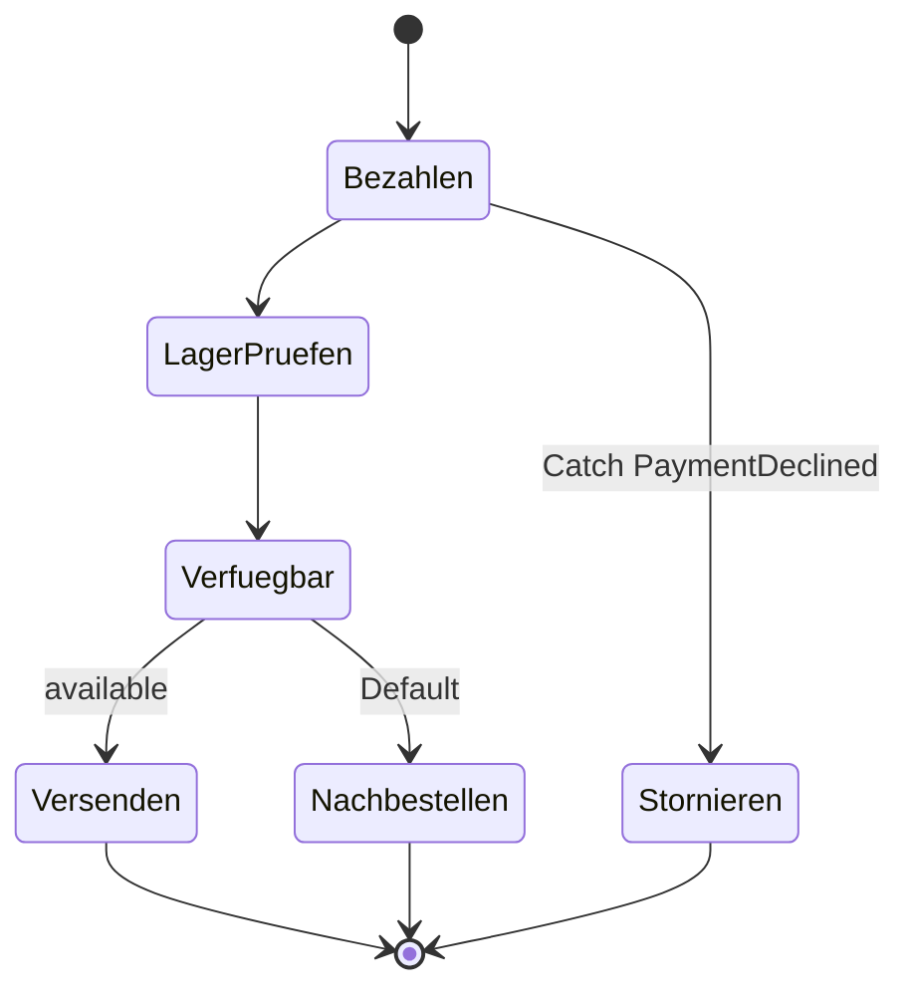

*English · [Deutsch](README.de.md)*

# 13 · Workflows with Step Functions

**ID:** `aws-step-functions`

## Task

Model charging, checking stock and shipping as a Standard Workflow with a retry for the payment and a catch that cancels the order.



The state names are German and come from the code: `Bezahlen` (charge), `LagerPruefen` (check stock), `Verfuegbar` (available), `Versenden` (ship), `Nachbestellen` (reorder), `Stornieren` (cancel).

## Steps

1. The steps are ready in [`start/src/steps.ts`](start/src/steps.ts) – including the errors `PaymentProviderTimeout` and `PaymentDeclined`.
2. [`start/lib/order-workflow-stack.ts`](start/lib/order-workflow-stack.ts) connects only charging and shipping. The workflow already uses JSONata as its query language.
3. Add the missing steps, the retry, the catch and the choice.
4. Remove the `.skip` in [`start/test/order-workflow-stack.test.ts`](start/test/order-workflow-stack.test.ts).
5. Deploy and start four executions:

   ```bash
   cd exercises/13-aws-step-functions/start
   npx cdk deploy
   SM=<StateMachineArn>
   aws stepfunctions start-execution --state-machine-arn $SM \
     --input '{"orderId":"A7","amount":42,"items":[{"sku":"BOOK","quantity":1}]}'
   aws stepfunctions start-execution --state-machine-arn $SM \
     --input '{"orderId":"A8","amount":42,"items":[{"sku":"OUT_OF_STOCK-MUG","quantity":1}]}'
   aws stepfunctions start-execution --state-machine-arn $SM \
     --input '{"orderId":"A9","amount":42,"items":[],"simulate":"timeout"}'
   aws stepfunctions start-execution --state-machine-arn $SM \
     --input '{"orderId":"A10","amount":5000,"items":[]}'
   ```

6. Look at each execution as a graph in the console.

## Check

- A7 ends via `Versenden`, A8 via `Nachbestellen`.
- A9 shows four attempts for `Bezahlen` and then ends as a failure. A timeout is not a business error, so the workflow does not cancel.
- A10 goes straight to `Stornieren` without a retry.

## Going further

If a workflow waits for a person, for example an approval, you use `IntegrationPattern.WAIT_FOR_TASK_TOKEN`. A Standard Workflow may run for up to a year.

## Solution

[`solution/`](solution/)
