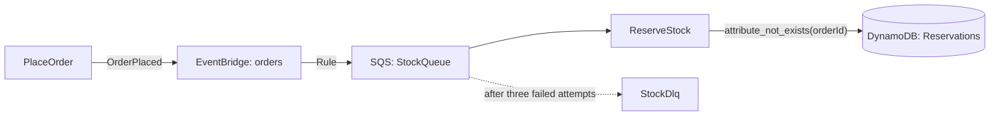

*English · [Deutsch](README.de.md)*

# 14 · Events and queues

**ID:** `aws-events-queues`

## Task

Publish `OrderPlaced` on EventBridge, route it via a rule into an SQS queue with a dead letter queue and process it idempotently with a partial batch response. You need no library for this: a loop with `try`/`catch` and a conditional write to DynamoDB are enough.



## Steps

1. The producer [`start/src/publish.ts`](start/src/publish.ts) is done. So is the business logic `reserveStock` in [`start/src/order.ts`](start/src/order.ts): it throws for products whose ID starts with `UNKNOWN`.
2. In [`start/lib/order-events-stack.ts`](start/lib/order-events-stack.ts), add the dead letter queue, the rule, the table `Reservations` and `reportBatchItemFailures`.
3. Rework the handler in [`start/src/reserve-stock.ts`](start/src/reserve-stock.ts): each message runs in `try`/`catch`, you collect failed ones as `{ itemIdentifier: record.messageId }` and return `{ batchItemFailures }`.
4. Make `reserveOnce` idempotent: write the reservation with `ConditionExpression: 'attribute_not_exists(orderId)'`. If DynamoDB throws `ConditionalCheckFailedException`, the order already existed. That is not an error: return `'duplicate'` instead of reporting the message back.
5. Remove the `.skip` in the tests.
6. Deploy and publish orders – A7 twice, one of them with an unknown product:

   ```bash
   cd exercises/14-aws-events-queues/start
   npx cdk deploy
   for id in A7 A7 A8; do
     aws lambda invoke --function-name <PlaceOrderName> --cli-binary-format raw-in-base64-out \
       --payload "{\"id\":\"$id\",\"customerId\":\"c-1\",\"items\":[{\"productId\":\"p-1\",\"quantity\":1,\"priceCents\":1299}]}" /dev/null
   done
   aws lambda invoke --function-name <PlaceOrderName> --cli-binary-format raw-in-base64-out \
     --payload '{"id":"A9","customerId":"c-1","items":[{"productId":"UNKNOWN-1","quantity":1,"priceCents":100}]}' /dev/null
   ```

7. Look at the logs of `ReserveStock` and, after a few minutes, at the DLQ:

   ```bash
   aws sqs receive-message --queue-url <DeadLetterQueueUrl>
   ```

## Check

- A7 appears only once in `Reservations`. The second delivery logs `"result":"duplicate"`.
- A9 ends up in the dead letter queue after three attempts. A7 and A8 still go through.
- The tests run without an AWS account.

## Going further

- If you need more than “already seen”, such as the stored result of the first call or expiry via TTL, use the idempotency module of Powertools for AWS Lambda.
- The visibility timeout of the queue is at least six times the timeout of the function. Otherwise a second consumer sees the message while the first one is still working.

## Solution

[`solution/`](solution/)
