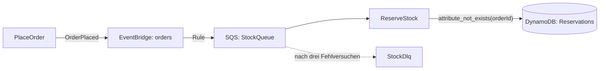

# 14 · Events und Queues

**ID:** `aws-events-queues`

## Aufgabe

Veröffentliche `OrderPlaced` auf EventBridge, leite es per Rule in eine SQS Queue mit Dead Letter Queue und verarbeite sie idempotent mit Partial Batch Response. Du brauchst dafür keine Bibliothek: eine Schleife mit `try`/`catch` und ein bedingtes Schreiben in DynamoDB reichen.



## Ablauf

1. Der Produzent [`start/src/publish.ts`](start/src/publish.ts) ist fertig. Die Fachlogik `reserveStock` in [`start/src/order.ts`](start/src/order.ts) auch: Sie wirft bei Produkten, deren ID mit `UNKNOWN` beginnt.
2. Ergänze in [`start/lib/order-events-stack.ts`](start/lib/order-events-stack.ts) die Dead Letter Queue, die Rule, die Table `Reservations` und `reportBatchItemFailures`.
3. Bau in [`start/src/reserve-stock.ts`](start/src/reserve-stock.ts) den Handler um: Jede Nachricht läuft in `try`/`catch`, fehlgeschlagene sammelst du als `{ itemIdentifier: record.messageId }` und gibst `{ batchItemFailures }` zurück.
4. Mach `reserveOnce` idempotent: Schreib die Reservierung mit `ConditionExpression: 'attribute_not_exists(orderId)'`. Wirft DynamoDB `ConditionalCheckFailedException`, gab es die Bestellung schon. Das ist kein Fehler: Gib `'duplicate'` zurück, statt die Nachricht zurückzumelden.
5. Entferne das `.skip` in den Tests.
6. Deploy und veröffentliche Bestellungen – A7 zweimal, eine davon mit unbekanntem Produkt:

   ```bash
   cd exercises/14-aws-events-queues/start
   npx cdk deploy
   for id in A7 A7 A8; do
     aws lambda invoke --function-name <PlaceOrderName> --cli-binary-format raw-in-base64-out \
       --payload "{\"id\":\"$id\",\"customerId\":\"c-1\",\"items\":[{\"productId\":\"p-1\",\"quantity\":1,\"priceCents\":1299}]}" /dev/null
   done
   aws lambda invoke --function-name <PlaceOrderName> --cli-binary-format raw-in-base64-out \
     --payload '{"id":"A9","customerId":"c-1","items":[{"productId":"UNKNOWN-1","quantity":1,"priceCents":100}]}' /dev/null
   ```

7. Sieh in den Logs von `ReserveStock` nach und nach ein paar Minuten in die DLQ:

   ```bash
   aws sqs receive-message --queue-url <DeadLetterQueueUrl>
   ```

## Prüfen

- A7 steht nur einmal in `Reservations`. Die zweite Zustellung loggt `"result":"duplicate"`.
- A9 landet nach drei Versuchen in der Dead Letter Queue. A7 und A8 laufen trotzdem durch.
- Die Tests laufen ohne AWS-Konto.

## Zum Weiterdenken

- Brauchst du mehr als „schon gesehen“, etwa das gespeicherte Ergebnis des ersten Aufrufs oder einen Ablauf per TTL, nimm das Idempotency-Modul von Powertools for AWS Lambda.
- Der Visibility Timeout der Queue ist mindestens sechsmal so lang wie der Timeout der Function. Sonst sieht ein zweiter Consumer die Nachricht, während der erste noch arbeitet.

## Lösung

[`solution/`](solution/)
