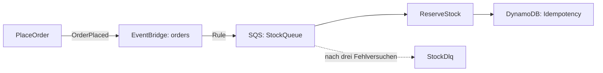

# 14 · Events und Queues

**Unit:** `aws-events-queues`

## Aufgabe

Veröffentliche `OrderPlaced` auf EventBridge, leite es per Rule in eine SQS Queue mit Dead Letter Queue und verarbeite sie idempotent mit Powertools.



## Ablauf

1. Der Produzent [`start/src/publish.ts`](start/src/publish.ts) ist fertig.
2. Ergänze in [`start/lib/order-events-stack.ts`](start/lib/order-events-stack.ts) die Dead Letter Queue, die Rule, die Idempotency Table und `reportBatchItemFailures`.
3. Bau [`start/src/reserve-stock.ts`](start/src/reserve-stock.ts) auf `BatchProcessor` und `processPartialResponse` um und sichere `reserveStock` mit `makeIdempotent` ab.
4. Entferne das `.skip` in den Tests.
5. Deploy und veröffentliche Bestellungen – eine davon mit unbekanntem Artikel:

   ```bash
   cd exercises/14-aws-events-queues/start
   npx cdk deploy
   for id in A7 A7 A8; do
     aws lambda invoke --function-name <PlaceOrderName> --cli-binary-format raw-in-base64-out \
       --payload "{\"id\":\"$id\",\"total\":42,\"items\":[{\"sku\":\"BOOK\",\"quantity\":1}]}" /dev/null
   done
   aws lambda invoke --function-name <PlaceOrderName> --cli-binary-format raw-in-base64-out \
     --payload '{"id":"A9","total":1,"items":[{"sku":"UNKNOWN-1","quantity":1}]}' /dev/null
   ```

6. Sieh in den Logs von `ReserveStock` nach und nach ein paar Minuten in die DLQ:

   ```bash
   aws sqs receive-message --queue-url <DeadLetterQueueUrl>
   ```

## Prüfen

- A7 wird nur einmal reserviert, obwohl das Event zweimal kam.
- A9 landet nach drei Versuchen in der Dead Letter Queue. A7 und A8 laufen trotzdem durch.

## Lösung

[`solution/`](solution/)
