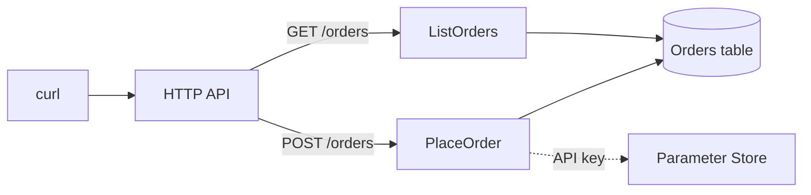

*English · [Deutsch](README.de.md)*

# 17 · Practice part one: the order reaches the table

**ID:** `aws-lab-end-to-end`

## Task

Combine the solutions from exercises 02 to 08 into one stack: `POST /orders` stores an order, `GET /orders` reads it. Deploy and check with curl.



| Component | comes from | File in `start/` |
| --- | --- | --- |
| `parseOrder`, `totalCents` | [02](../02-aws-lambda-handler/solution/src/order.ts) | `src/order.ts` |
| Stack, `NodejsFunction` | [03](../03-aws-cdk-basics/solution/lib/orders-stack.ts) | `lib/orders-stack.ts` |
| Permissions via `grant…` | [04](../04-aws-iam-least-privilege/solution/lib/orders-stack.ts) | `lib/orders-stack.ts` |
| HTTP API, handlers | [05](../05-aws-api-gateway-http/solution/) | `lib/orders-stack.ts`, `src/place-order.ts`, `src/list-orders.ts` |
| Keys `CUSTOMER#…` / `ORDER#…` | [06](../06-aws-dynamodb-modeling/solution/src/keys.ts), [07](../07-aws-dynamodb-single-table/) | `src/orders.ts` |
| API key from Parameter Store | [08](../08-aws-config-secrets/solution/src/charge-payment.ts) | `src/place-order.ts` |

## Steps

1. **Business logic:** Take `parseOrder` and `totalCents` from exercise 02 over to [`start/src/order.ts`](start/src/order.ts) and write `placeOrder`. Remove the `.skip` in `test/order.test.ts`.
2. **Table:** Write `saveOrder` and `listOrders` in [`start/src/orders.ts`](start/src/orders.ts). An order lives under `pk = CUSTOMER#<customerId>` and `sk = ORDER#<createdAt>#<orderId>`.
3. **Handlers:** Write the two thin handlers in `start/src/`. `PlaceOrder` loads the API key via Powertools Parameters with a cache. Remove the `.skip` in `test/handlers.test.ts`.
4. **Stack:** Work through the TODOs in [`start/lib/orders-stack.ts`](start/lib/orders-stack.ts). The stack is called `OrdersStack`, the output `ApiUrl`. Remove the `.skip` in `test/orders-stack.test.ts`.
5. **Tests:**

   ```bash
   npx vitest --project start exercises/17-aws-lab-end-to-end
   ```

6. **Create the secret:** CloudFormation cannot create SecureStrings, so you do that once via the CLI. Without the parameter, `POST /orders` responds with 500.

   ```bash
   aws ssm put-parameter --name /werkstatt/payments/api-key --type SecureString --value 'test-key-123'
   ```

7. **Deploy and check:**

   ```bash
   cd exercises/17-aws-lab-end-to-end/start
   npx cdk diff
   npx cdk deploy --outputs-file outputs.json
   API=$(jq -r '.OrdersStack.ApiUrl' outputs.json)
   curl -X POST "$API/orders" -H 'content-type: application/json' \
     -d '{"customerId":"c-1","items":[{"productId":"p-1","quantity":2,"priceCents":1299}]}'
   curl "$API/orders?customerId=c-1"
   ```

## Check

- `npx cdk synth` runs without errors, all tests are green.
- `POST /orders` responds with `201` and `"totalCents": 2598`, an order without line items with `400`.
- `GET /orders?customerId=c-1` returns the order, newest first and without `pk`/`sk`.
- `PlaceOrder` may write and read the key, `ListOrders` may only read. Check this in the template under `AWS::IAM::Policy`.
- The logs of `PlaceOrder` contain no API key.

## Cleanup

Part two ([18](../18-aws-lab-fulfillment)) extends exactly this stack. If you continue, leave it in place. Otherwise:

```bash
npx cdk destroy
aws ssm delete-parameter --name /werkstatt/payments/api-key
rm outputs.json
```

## Solution

[`solution/`](solution/) – `npx vitest run --project solution exercises/17-aws-lab-end-to-end`
