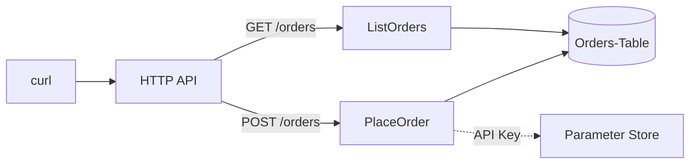

# 17 · Praxis Teil eins: die Bestellung bis in die Tabelle

**ID:** `aws-lab-end-to-end`

## Aufgabe

Führ die Lösungen aus den Übungen 02 bis 08 in einem Stack zusammen: `POST /orders` speichert eine Bestellung, `GET /orders` liest sie. Deploy und prüf per curl.



| Bestandteil | kommt aus | Datei in `start/` |
| --- | --- | --- |
| `parseOrder`, `totalCents` | [02](../02-aws-lambda-handler/solution/src/order.ts) | `src/order.ts` |
| Stack, `NodejsFunction` | [03](../03-aws-cdk-basics/solution/lib/orders-stack.ts) | `lib/orders-stack.ts` |
| Rechte per `grant…` | [04](../04-aws-iam-least-privilege/solution/lib/orders-stack.ts) | `lib/orders-stack.ts` |
| HTTP API, Handler | [05](../05-aws-api-gateway-http/solution/) | `lib/orders-stack.ts`, `src/place-order.ts`, `src/list-orders.ts` |
| Keys `CUSTOMER#…` / `ORDER#…` | [06](../06-aws-dynamodb-modeling/solution/src/keys.ts), [07](../07-aws-dynamodb-single-table/) | `src/orders.ts` |
| API Key aus Parameter Store | [08](../08-aws-config-secrets/solution/src/charge-payment.ts) | `src/place-order.ts` |

## Ablauf

1. **Fachlogik:** Übernimm `parseOrder` und `totalCents` aus Übung 02 nach [`start/src/order.ts`](start/src/order.ts) und schreib `placeOrder`. Entferne das `.skip` in `test/order.test.ts`.
2. **Tabelle:** Schreib `saveOrder` und `listOrders` in [`start/src/orders.ts`](start/src/orders.ts). Eine Bestellung liegt unter `pk = CUSTOMER#<customerId>` und `sk = ORDER#<createdAt>#<orderId>`.
3. **Handler:** Schreib die beiden dünnen Handler in `start/src/`. `PlaceOrder` lädt den API Key per Powertools Parameters mit Cache. Entferne das `.skip` in `test/handlers.test.ts`.
4. **Stack:** Arbeite die TODOs in [`start/lib/orders-stack.ts`](start/lib/orders-stack.ts) ab. Der Stack heißt `OrdersStack`, der Output `ApiUrl`. Entferne das `.skip` in `test/orders-stack.test.ts`.
5. **Tests:**

   ```bash
   npx vitest --project start exercises/17-aws-lab-end-to-end
   ```

6. **Secret anlegen:** CloudFormation kann keine SecureStrings anlegen, das machst du einmal per CLI. Ohne den Parameter antwortet `POST /orders` mit 500.

   ```bash
   aws ssm put-parameter --name /werkstatt/payments/api-key --type SecureString --value 'test-key-123'
   ```

7. **Deployen und prüfen:**

   ```bash
   cd exercises/17-aws-lab-end-to-end/start
   npx cdk diff
   npx cdk deploy --outputs-file outputs.json
   API=$(jq -r '.OrdersStack.ApiUrl' outputs.json)
   curl -X POST "$API/orders" -H 'content-type: application/json' \
     -d '{"customerId":"c-1","items":[{"productId":"p-1","quantity":2,"priceCents":1299}]}'
   curl "$API/orders?customerId=c-1"
   ```

## Prüfen

- `npx cdk synth` läuft ohne Fehler, alle Tests sind grün.
- `POST /orders` antwortet mit `201` und `"totalCents": 2598`, eine Bestellung ohne Positionen mit `400`.
- `GET /orders?customerId=c-1` liefert die Bestellung zurück, neueste zuerst und ohne `pk`/`sk`.
- `PlaceOrder` darf schreiben und den Key lesen, `ListOrders` nur lesen. Prüf das im Template unter `AWS::IAM::Policy`.
- In den Logs von `PlaceOrder` steht kein API Key.

## Aufräumen

Teil zwei ([18](../18-aws-lab-fulfillment)) erweitert genau diesen Stack. Wenn du weitermachst, lass ihn stehen. Sonst:

```bash
npx cdk destroy
aws ssm delete-parameter --name /werkstatt/payments/api-key
rm outputs.json
```

## Lösung

[`solution/`](solution/) – `npx vitest run --project solution exercises/17-aws-lab-end-to-end`
