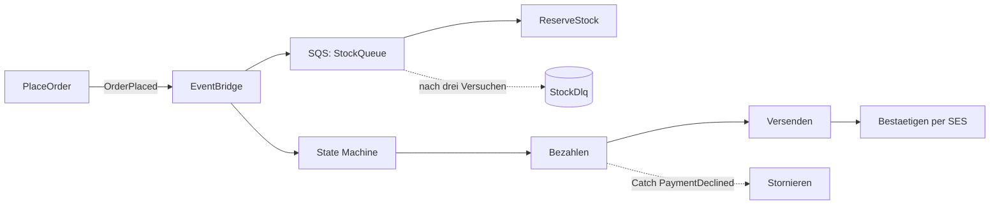

# 18 · Praxis Teil zwei: vom Event bis zum Versand

**Unit:** `aws-lab-fulfillment`

## Aufgabe

Erweitere den Stack aus Teil eins mit den Übungen 12 bis 15: `OrderPlaced` über EventBridge und SQS, Bezahlung und Versand als Step Function, Mail per SES, Cold Start messen.



[`start/`](start/) ist die Lösung von [Teil eins](../17-aws-lab-end-to-end) plus Platzhalter für die neuen Dateien. Der Stack heißt weiter `OrdersStack`: Ein Deploy aktualisiert den Stack aus Teil eins, statt einen zweiten anzulegen.

| Baustein | kommt aus | Datei in `start/` |
| --- | --- | --- |
| `OrderPlaced` veröffentlichen | [14](../14-aws-events-queues/solution/src/publish.ts) | `src/events.ts`, `src/place-order.ts` |
| Queue, DLQ, Partial Batch Response, Conditional Write | [14](../14-aws-events-queues/solution/) | `src/reserve-stock.ts`, `lib/orders-stack.ts` |
| State Machine mit Retry und Catch | [13](../13-aws-step-functions/solution/lib/order-workflow-stack.ts) | `src/steps.ts`, `lib/orders-stack.ts` |
| Mail per SES | [12](../12-aws-ses-mail/solution/src/send-confirmation.ts) | `src/send-confirmation.ts` |
| REPORT-Zeilen auswerten | [15](../15-aws-cold-starts/solution/src/analyze-logs.ts) | – |

## Vorher

- Teil eins ist deployt, der Parameter `/werkstatt/payments/api-key` existiert.
- **SES-Sandbox:** Absender und Empfänger müssen verifiziert sein. Hast du Übung 12 gemacht, ist der Absender es schon. Sonst:

  ```bash
  aws sesv2 create-email-identity --email-identity du@example.com   # Link in der Mail anklicken
  ```

  Der Stack legt keine Identity an. So kollidiert er nicht mit Übung 12.

## Ablauf

1. **Event:** Schreib `publishOrderPlaced` in [`start/src/events.ts`](start/src/events.ts) und ruf es in `place-order.ts` nach `saveOrder` auf. Erst speichern, dann veröffentlichen.
2. **Lager:** Schreib [`start/src/reserve-stock.ts`](start/src/reserve-stock.ts): Schleife mit `try`/`catch`, `batchItemFailures`, Reservierung per Conditional Write auf `ORDER#<orderId>` / `RESERVATION`. Eine doppelte Zustellung ist kein Fehler.
3. **Workflow:** Schreib `cancelOrder` in [`start/src/steps.ts`](start/src/steps.ts) und die Bestätigung in [`start/src/send-confirmation.ts`](start/src/send-confirmation.ts).
4. **Stack:** Arbeite die TODOs „Teil zwei“ in [`start/lib/orders-stack.ts`](start/lib/orders-stack.ts) ab.
5. Entferne das `.skip` in den Tests und lass sie laufen:

   ```bash
   npx vitest --project start exercises/18-aws-lab-fulfillment
   ```

6. **Deployen** mit deinen verifizierten Adressen:

   ```bash
   cd exercises/18-aws-lab-fulfillment/start
   npx cdk diff -c fromAddress=du@example.com -c toAddress=du@example.com
   npx cdk deploy -c fromAddress=du@example.com -c toAddress=du@example.com --outputs-file outputs.json
   API=$(jq -r '.OrdersStack.ApiUrl' outputs.json)
   ```

7. **Durchspielen:**

   ```bash
   # normal: bezahlt, versendet, Mail kommt an
   curl -X POST "$API/orders" -H 'content-type: application/json' \
     -d '{"customerId":"c-1","items":[{"productId":"p-1","quantity":2,"priceCents":1299}]}'
   # über 1000 Euro: Zahlung abgelehnt, Bestellung storniert
   curl -X POST "$API/orders" -H 'content-type: application/json' \
     -d '{"customerId":"c-1","items":[{"productId":"p-1","quantity":100,"priceCents":1299}]}'
   # unbekanntes Produkt: Reservierung scheitert, Nachricht landet in der DLQ
   curl -X POST "$API/orders" -H 'content-type: application/json' \
     -d '{"customerId":"c-1","items":[{"productId":"UNKNOWN-1","quantity":1,"priceCents":100}]}'
   curl "$API/orders?customerId=c-1"
   ```

   Sieh dir die Ausführungen der State Machine in der Console als Graph an. Nach ein paar Minuten:

   ```bash
   aws sqs receive-message --queue-url "$(jq -r '.OrdersStack.StockDlqUrl' outputs.json)"
   ```

8. **Cold Start messen**, bevor du optimierst. Ruf `PlaceOrder` ein paar Mal auf und werte die REPORT-Zeilen mit dem Skript aus Übung 15 aus:

   ```bash
   FN=$(jq -r '.OrdersStack.PlaceOrderName' outputs.json)
   aws logs filter-log-events --log-group-name "/aws/lambda/$FN" --filter-pattern REPORT \
     --query 'events[].message' --output text | node ../../15-aws-cold-starts/solution/src/analyze-logs.ts
   ```

## Prüfen

- `npx cdk synth` läuft ohne Fehler, alle Tests sind grün.
- Die erste Bestellung endet in der State Machine über `Fertig`, die Mail „Bestellung … bestätigt“ kommt an.
- Die Bestellung über 1000 Euro endet über `Stornieren` und steht per `GET /orders` mit `"status": "cancelled"` da.
- Die Bestellung mit `UNKNOWN-1` liegt nach drei Versuchen in der DLQ. Die anderen Nachrichten im selben Batch laufen trotzdem durch.
- Stellt SQS `OrderPlaced` zweimal zu, loggt `ReserveStock` beim zweiten Mal `"result":"duplicate"`. Die Reservierung gibt es nur einmal.
- Du kennst die durchschnittliche Init Duration von `PlaceOrder`.

## Aufräumen

```bash
npx cdk destroy
aws ssm delete-parameter --name /werkstatt/payments/api-key
rm outputs.json
```

Verifizierte SES-Adressen bleiben stehen. Brauchst du sie nicht mehr: `aws sesv2 delete-email-identity --email-identity du@example.com`.

## Lösung

[`solution/`](solution/) – `npx vitest run --project solution exercises/18-aws-lab-fulfillment`
