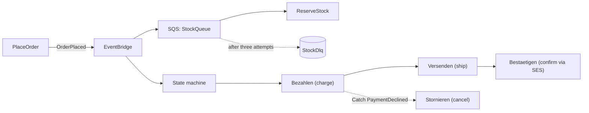

*English · [Deutsch](README.de.md)*

# 18 · Hands-on part two: from event to shipping

**ID:** `aws-lab-fulfillment`

## Task

Extend the stack from part one with exercises 12 to 15: `OrderPlaced` via EventBridge and SQS, payment and shipping as a Step Function, mail via SES, measuring the cold start.



[`start/`](start/) is the solution of [part one](../17-aws-lab-end-to-end) plus placeholders for the new files. The stack is still called `OrdersStack`: a deploy updates the stack from part one instead of creating a second one.

| Component | comes from | File in `start/` |
| --- | --- | --- |
| Publish `OrderPlaced` | [14](../14-aws-events-queues/solution/src/publish.ts) | `src/events.ts`, `src/place-order.ts` |
| Queue, DLQ, partial batch response, conditional write | [14](../14-aws-events-queues/solution/) | `src/reserve-stock.ts`, `lib/orders-stack.ts` |
| State machine with retry and catch | [13](../13-aws-step-functions/solution/lib/order-workflow-stack.ts) | `src/steps.ts`, `lib/orders-stack.ts` |
| Mail via SES | [12](../12-aws-ses-mail/solution/src/send-confirmation.ts) | `src/send-confirmation.ts` |
| Evaluate REPORT lines | [15](../15-aws-cold-starts/solution/src/analyze-logs.ts) | – |

## Before you start

- Part one is deployed, the parameter `/werkstatt/payments/api-key` exists.
- **SES sandbox:** Sender and recipient must be verified. If you did exercise 12, the sender already is. Otherwise:

  ```bash
  aws sesv2 create-email-identity --email-identity du@example.com   # click the link in the mail
  ```

  The stack creates no identity. This way it does not collide with exercise 12.

## Steps

1. **Event:** Write `publishOrderPlaced` in [`start/src/events.ts`](start/src/events.ts) and call it in `place-order.ts` after `saveOrder`. Save first, then publish.
2. **Stock:** Write [`start/src/reserve-stock.ts`](start/src/reserve-stock.ts): a loop with `try`/`catch`, `batchItemFailures`, reservation via conditional write on `ORDER#<orderId>` / `RESERVATION`. A duplicate delivery is not an error.
3. **Workflow:** Write `cancelOrder` in [`start/src/steps.ts`](start/src/steps.ts) and the confirmation in [`start/src/send-confirmation.ts`](start/src/send-confirmation.ts).
4. **Stack:** Work through the TODOs under “Part two” in [`start/lib/orders-stack.ts`](start/lib/orders-stack.ts).
5. Remove the `.skip` in the tests and run them:

   ```bash
   npx vitest --project start exercises/18-aws-lab-fulfillment
   ```

6. **Deploy** with your verified addresses:

   ```bash
   cd exercises/18-aws-lab-fulfillment/start
   npx cdk diff -c fromAddress=du@example.com -c toAddress=du@example.com
   npx cdk deploy -c fromAddress=du@example.com -c toAddress=du@example.com --outputs-file outputs.json
   API=$(jq -r '.OrdersStack.ApiUrl' outputs.json)
   ```

7. **Walk through it:**

   ```bash
   # normal: charged, shipped, mail arrives
   curl -X POST "$API/orders" -H 'content-type: application/json' \
     -d '{"customerId":"c-1","items":[{"productId":"p-1","quantity":2,"priceCents":1299}]}'
   # above 1,000 euros: payment declined, order cancelled
   curl -X POST "$API/orders" -H 'content-type: application/json' \
     -d '{"customerId":"c-1","items":[{"productId":"p-1","quantity":100,"priceCents":1299}]}'
   # unknown product: reservation fails, message ends up in the DLQ
   curl -X POST "$API/orders" -H 'content-type: application/json' \
     -d '{"customerId":"c-1","items":[{"productId":"UNKNOWN-1","quantity":1,"priceCents":100}]}'
   curl "$API/orders?customerId=c-1"
   ```

   Look at the executions of the state machine as a graph in the console. After a few minutes:

   ```bash
   aws sqs receive-message --queue-url "$(jq -r '.OrdersStack.StockDlqUrl' outputs.json)"
   ```

8. **Measure the cold start** before you optimize. Invoke `PlaceOrder` a few times and evaluate the REPORT lines with the script from exercise 15:

   ```bash
   FN=$(jq -r '.OrdersStack.PlaceOrderName' outputs.json)
   aws logs filter-log-events --log-group-name "/aws/lambda/$FN" --filter-pattern REPORT \
     --query 'events[].message' --output text | node ../../15-aws-cold-starts/solution/src/analyze-logs.ts
   ```

## Check

- `npx cdk synth` runs without errors, all tests are green.
- The first order ends in the state machine via `Fertig`, the mail “Bestellung … bestätigt” arrives.
- The order above 1,000 euros ends via `Stornieren` and shows up in `GET /orders` with `"status": "cancelled"`.
- The order with `UNKNOWN-1` is in the DLQ after three attempts. The other messages in the same batch still go through.
- If SQS delivers `OrderPlaced` twice, `ReserveStock` logs `"result":"duplicate"` the second time. The reservation exists only once.
- You know the average Init Duration of `PlaceOrder`.

## Cleanup

```bash
npx cdk destroy
aws ssm delete-parameter --name /werkstatt/payments/api-key
rm outputs.json
```

Verified SES addresses stay in place. If you no longer need them: `aws sesv2 delete-email-identity --email-identity du@example.com`.

## Solution

[`solution/`](solution/) – `npx vitest run --project solution exercises/18-aws-lab-fulfillment`
